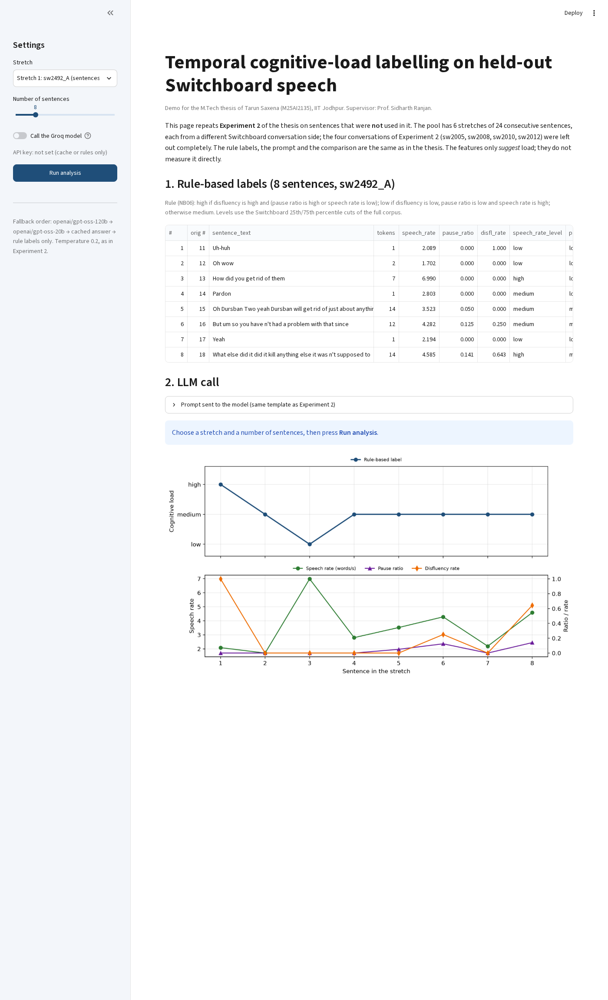
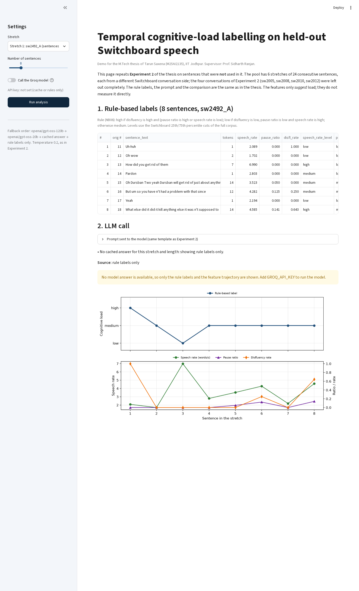
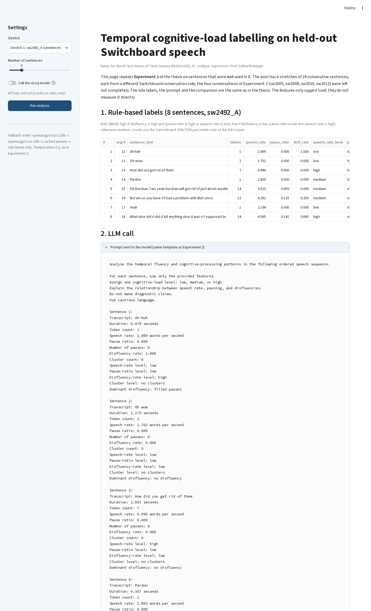

# MTP demo: temporal cognitive-load labelling on new Switchboard sentences

This is the demo for my M.Tech thesis at IIT Jodhpur, "LLM-based Temporal
Reasoning for Cognitive Load and Disfluency Analysis in Spontaneous Speech"
(Tarun Saxena, M25AI2135, supervisor Prof. Sidharth Ranjan).

[](https://colab.research.google.com/github/saxetar/mtp-temporal-cognitive-load/blob/main/colab/MTP_demo_colab_verified.ipynb)

I also made a Colab notebook (`colab/MTP_demo_colab_verified.ipynb`). It runs the same
steps as the Streamlit app, with the same code, and it reads `GROQ_API_KEY` from Colab
Secrets, so the key is never written in the notebook.

In this demo, I repeat Experiment 2 of my thesis on Switchboard sentences. You choose a stretch of speech and how many sentences
to use (4 to 24). The page then shows:

1. the rule-based load label for each sentence,
2. the prompt I send to the LLM on Groq (the same prompt template as Experiment 2),
3. the comparison between the two sets of labels: agreement, confusion matrix
   (a table of which rule label met which LLM label), macro-F1 (the F1 score
   averaged over low, medium and high) and Cohen's kappa (agreement corrected for chance),
4. a plot of how the labels and the three main features change across the stretch,
5. the model's own explanation for every sentence where the two labels differ.

The features only suggest cognitive load. They do not measure it directly, and
the demo makes no diagnostic claims.



**Streamlit Cloud main file path:** `demo/app.py`

## What data the demo uses

I made a small held-out pool (`demo/demo_data/heldout_pool.csv`, about 40 KB). It has
6 stretches of 24 consecutive sentences each, so 144 sentences in total. Each
stretch comes from a different Switchboard conversation side (one speaker in one
conversation).

- I left out the four conversations used in Experiment 2
  (sw2005, sw2008, sw2010, sw2012), both sides, so none of
  the 396 thesis sentences and none of those speakers' dialogues are in the pool.
- From the remaining 1,146 sides that had a usable stretch, I picked 6 sides with
  random seed 42, each from a different conversation, and then one stretch per side
  with the same seed.
- A usable stretch has 24 sentences with consecutive sentence numbers, and its
  first four sentences have at least 10 tokens (the same minimum as Experiment 2).
- The file keeps only the transcript text and the features. No audio is included.

| Stretch | Conversation side | Original sentences | Tokens | One-word sentences |
|---|---|---|---|---|
| 1 | sw2492_A | 11-34 | 248 | 10 |
| 2 | sw3638_B | 2-25 | 297 | 3 |
| 3 | sw3093_B | 20-43 | 485 | 5 |
| 4 | sw3315_B | 11-34 | 264 | 1 |
| 5 | sw2672_A | 15-38 | 256 | 13 |
| 6 | sw3099_A | 21-44 | 374 | 5 |

The feature levels (low, medium, high) use the same Switchboard cut-offs as the
thesis: the 25th and 75th percentiles of the full corpus of 67,723 units. They are
saved in `demo/demo_data/pool_manifest.json`. The script that builds the pool is
`demo/tools/build_pool.py`.

## How the labels are made

I did not make a new rule for the demo. `demo/method.py` contains the same code as
`mtp/s06_llm_temporal.py` in my replication package:

- **Rule label:** high if the disfluency rate is high and (the pause ratio is high
  or the speech rate is low); low if the disfluency rate is low, the pause ratio is
  low and the speech rate is high; medium otherwise.
- **LLM prompt:** the Experiment 2 template, word for word. The model is
  `openai/gpt-oss-120b` at temperature 0.2.
- **Reading the answer:** the same regular expression (text pattern) as in
  Experiment 2 picks out "Sentence k: Cognitive load: ...".

The test `demo/tests/test_demo.py` checks that the demo builds exactly the same 50
prompts and the same 396 rule labels as my saved Experiment 2 outputs, and that it
reads the same 396 LLM labels from the saved answers.

## What happens if the model call fails

The demo tries these in order:

1. `openai/gpt-oss-120b` on Groq,
2. `openai/gpt-oss-20b` on Groq,
3. a saved (cached) answer from `demo/cache/` for the same stretch and length,
4. rule labels only, with the feature plot.

The page always says which of these was used.

Note on the cache: the cache is empty at the moment. In my thesis notebooks I kept
the Groq key in Colab Secrets, so it is not stored anywhere in the project. I did
not put any made-up answers in the cache. So, without a key, the demo shows the
rule labels and the feature plot only (step 4 above). To fill the cache with real
answers, run this from the root of the repository with your key set:

```bash
export GROQ_API_KEY=...        # your own key; do not commit it
python demo/tools/make_cache.py --lengths 8 24
```

This saves one answer per stretch for 8 and 24 sentences. Each file stores the
model name, the time and a hash (fingerprint) of the prompt, so a cached answer is
only used for exactly the same prompt.

## Running it on your own computer

From the root of the repository:

```bash
git clone https://github.com/saxetar/mtp-temporal-cognitive-load.git
cd mtp-temporal-cognitive-load
pip install -r requirements.txt
streamlit run demo/app.py
```

Then open http://localhost:8501 in a browser.

To use the LLM, give the demo a Groq key in one of two ways:

```bash
export GROQ_API_KEY=...        # option 1: environment variable
```

or create `.streamlit/secrets.toml` in the root of the repository with:

```toml
GROQ_API_KEY = "your-key-here"
```

Never write the key in `app.py` or commit `secrets.toml` to GitHub (it is listed
in `.gitignore`). Without a key
the demo still runs, using the cache or the rule labels only.

To run the tests:

```bash
pip install pytest
python -m pytest -q demo/tests
```

## Putting it on Streamlit Community Cloud

1. Go to https://share.streamlit.io and sign in with GitHub.
2. Click **Create app** and choose **Deploy a public app from GitHub**.
3. Fill in:
   - Repository: `saxetar/mtp-temporal-cognitive-load`
   - Branch: `main`
   - Main file path: `demo/app.py`
4. Open **Advanced settings → Secrets** and paste:
   ```toml
   GROQ_API_KEY = "your-key-here"
   ```
   You can skip this step. Then the demo runs in rules-only mode.
5. Click **Deploy**. Streamlit installs `requirements.txt` from the root by itself.
   After a few minutes you get a public link that you can share.

The theme is in `.streamlit/config.toml` at the root of the repository, which is
where Community Cloud looks for it.

## Screenshots

| Start page | After "Run analysis" (rules-only mode) | Prompt sent to the model |
|---|---|---|
|  |  |  |

These were taken without a Groq key, so they show the rules-only mode. With a key
(or a filled cache), the page also shows the comparison, the confusion matrix and
the reasons for each mismatch.

## Files

```
.
├── README.md
├── requirements.txt         Python packages (used by Streamlit Cloud too)
├── .streamlit/config.toml   theme and server settings
├── .gitignore
├── docs/                    screenshots
├── colab/
│   └── MTP_demo_colab_verified.ipynb   the same demo as a Colab notebook
└── demo/
    ├── app.py               the Streamlit page (main file)
    ├── method.py            rule, prompt, answer reader and metrics (from the pipeline)
    ├── demo_data/
    │   ├── heldout_pool.csv     6 x 24 held-out sentences (text + features)
    │   └── pool_manifest.json   how the pool was chosen, cut-offs, excluded conversations
    ├── cache/               saved real LLM answers (empty for now)
    ├── tools/
    │   ├── build_pool.py    rebuilds the pool from the full NB05 output
    │   └── make_cache.py    fills cache/ with real Groq answers
    └── tests/test_demo.py
```

The full replication pipeline for the thesis (notebooks 01 to 06) is shared
separately. Two tests need its Experiment 2 outputs; set `MTP_EXP2_DIR` to that
folder to run them. Without it they are skipped.

## Data licence

The sentences come from Switchboard NXT (Linguistic Data Consortium, LDC2009T26).
I include this small sample (144 sentences, text and features only, no audio) so
that the thesis demo can be run and checked for academic purposes. Please check the
LDC terms before you reuse it. The code is for academic use with my thesis.
